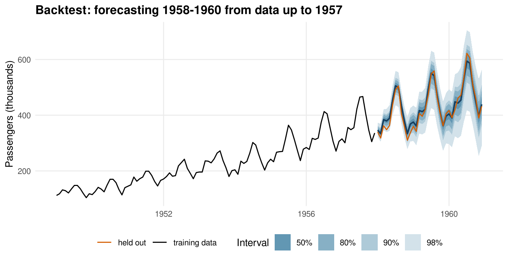
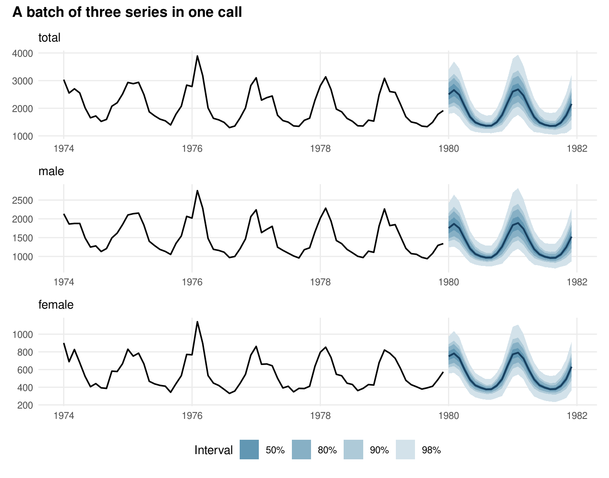
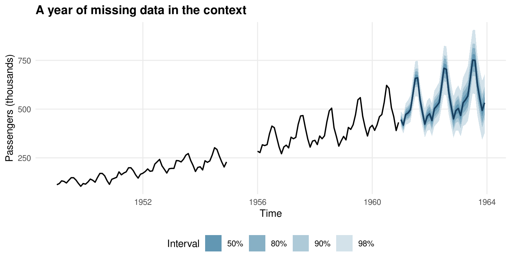
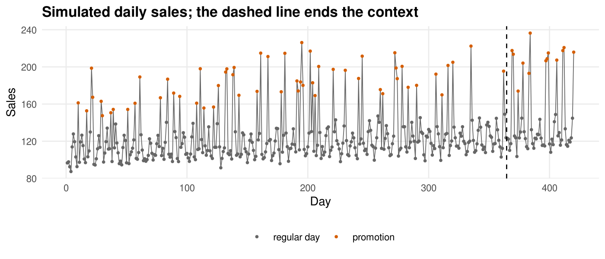
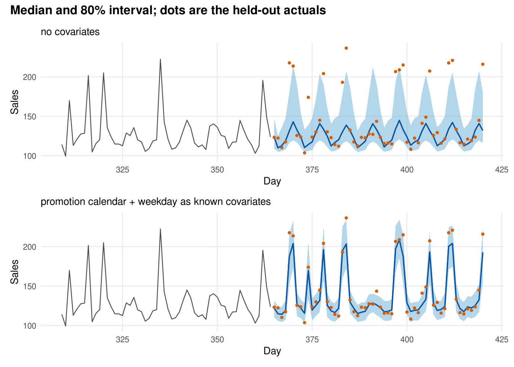
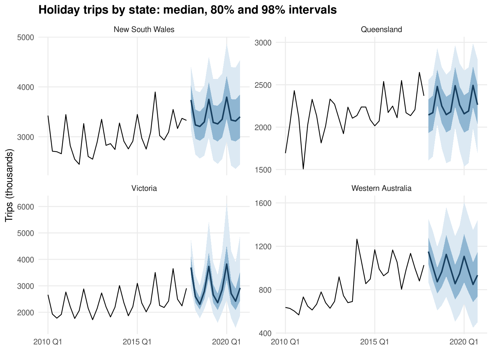
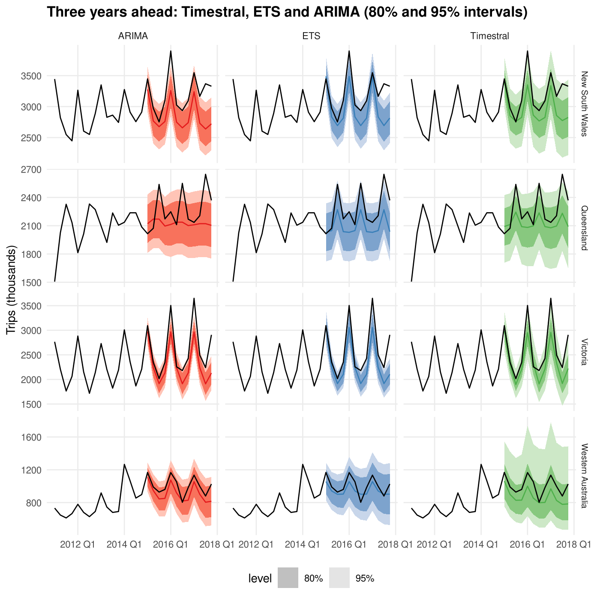

<!--
This vignette is precomputed: it needs a model checkpoint (downloaded
on first use) and a few seconds of compute per forecast, neither of
which belongs in R CMD check. Edit timestralR.Rmd.orig, then rebuild
timestralR.Rmd and its figures with vignettes/precompile.R.
-->


timestralR runs Mistral AI's [Timestral](https://huggingface.co/mistralai)
time-series foundation models directly in R. Timestral is a *zero-shot*
forecaster: it is pretrained on a large corpus of time series, so you
give it a context (the history you have) and a horizon, and it returns
a full predictive distribution without any fitting. Every forecast has
21 quantiles per step, from the 1% to the 99% level.

The package has no Python or PyTorch dependency. The official
`safetensors` checkpoints are downloaded once, and the transformer runs
natively on R's BLAS.

This vignette covers the whole interface:

1. loading a model and making a first forecast;
2. working with the forecast: quantiles, data frames and plots;
3. multivariate series and batches of series;
4. missing values and observation masks;
5. numeric and categorical covariates;
6. time indexes from `ts`, `zoo` and `xts`;
7. the tidyverts: `tsibble` input and output, and `fable` integration;
8. options, backends, and using the package in parallel code.


```r
library(timestralR)
library(ggplot2)
library(patchwork)

theme_set(theme_minimal(base_size = 10) +
            theme(legend.position = "bottom",
                  panel.grid.minor = element_blank(),
                  plot.title = element_text(face = "bold")))
```

## 1. Loading a model

Checkpoints come in four sizes: `"5M"`, `"28M"`, `"123M"` and `"209M"`.
They range from 21 MB to 837 MB on disk. `timestral_load()` downloads a
checkpoint to a per-user cache on first use; afterwards it loads from
disk. A local directory holding `config.json` and `model.safetensors`
also works.


```r
m <- timestral_load("28M")
m
#> <timestral_model> main  d_model = 384  layers = 12  max_context = 32768
```

The quantile levels are the same for every forecast:


```r
timestral_levels()
#>  [1] 0.01 0.05 0.10 0.15 0.20 0.25 0.30 0.35 0.40 0.45 0.50 0.55 0.60 0.65 0.70
#> [16] 0.75 0.80 0.85 0.90 0.95 0.99
```

## 2. A first forecast

`timestral_forecast()` takes a model, a series `y`, and a horizon `h`.
Here we forecast three years of the classic airline passengers series.


```r
fc <- timestral_forecast(m, AirPassengers, h = 36)
fc
#> <timestral_forecast> 1 variate(s), h = 36, 21 quantiles
#>     med
#> 1 447.3
#> 2 416.7
#> 3 469.4
#> 4 480.4
#> 5 496.5
#> 6 576.1
```

The `plot()` method draws a fan chart: the observed history, the median
forecast, and nested 50%, 80%, 90% and 98% central intervals.


```r
plot(fc, main = "AirPassengers: 36-month Timestral forecast",
     ylab = "Passengers (thousands)")
```


### Extracting results

The full forecast is a (variate, step, level) array in `fc$quantiles`.
The accessors return single levels; because the input was a `ts`, they
return a `ts` that starts right after the data.


```r
dim(fc$quantiles)
#> [1]  1 36 21
window(timestral_median(fc), end = c(1961, 6))
#>        Jan   Feb   Mar   Apr   May   Jun
#> 1961 447.3 416.7 469.4 480.4 496.5 576.1
window(timestral_quantile(fc, 0.9), end = c(1961, 6))
#>        Jan   Feb   Mar   Apr   May   Jun
#> 1961 465.2 439.3 494.0 506.9 525.3 608.9
```

`as_forecast_df()` gives a tidy long data frame with one column per
quantile level and the forecast time:


```r
head(as_forecast_df(fc)[, c("variate", "step", "time", "q10", "q50", "q90")])
#>   variate step time   q10   q50   q90
#> 1      V1    1 1961 430.6 447.3 465.2
#> 2      V1    2 1961 395.6 416.7 439.3
#> 3      V1    3 1961 446.4 469.4 494.0
#> 4      V1    4 1961 454.9 480.4 506.9
#> 5      V1    5 1961 469.4 496.5 525.3
#> 6      V1    6 1961 547.4 576.1 608.9
```

### ggplot2

When ggplot2 is installed, `autoplot()` draws the same fan chart as a
ggplot object, so the usual ggplot2 modifications apply.


```r
autoplot(fc) +
  labs(title = "AirPassengers", y = "Passengers (thousands)")
```


`autolayer()` adds only the forecast bands and median to an existing
plot. A natural use is a backtest. Hold out the last three years,
forecast them, and overlay what actually happened:


```r
train <- window(AirPassengers, end = c(1957, 12))
test  <- window(AirPassengers, start = c(1958, 1))
fc_bt <- timestral_forecast(m, train, h = length(test))

actual <- data.frame(time = as.numeric(time(AirPassengers)),
                     value = as.numeric(AirPassengers),
                     part = ifelse(time(AirPassengers) < 1958,
                                   "training data", "held out"))
ggplot(actual, aes(time, value)) +
  autolayer(fc_bt) +
  geom_line(aes(colour = part), linewidth = 0.5) +
  scale_colour_manual(values = c("training data" = "black",
                                 "held out" = "#D55E00"), name = NULL) +
  labs(title = "Backtest: forecasting 1958-1960 from data up to 1957",
       x = NULL, y = "Passengers (thousands)")
```



How well calibrated are the intervals here? The share of held-out
months inside each central interval:


```r
q <- fc_bt$quantiles[1, , ]
lv <- fc_bt$levels
inside <- function(p) {
  lo <- q[, which.min(abs(lv - (1 - p) / 2))]
  hi <- q[, which.min(abs(lv - (1 + p) / 2))]
  mean(test >= lo & test <= hi)
}
data.frame(interval = c("50%", "80%", "90%", "98%"),
           coverage = sapply(c(0.5, 0.8, 0.9, 0.98), inside))
#>   interval coverage
#> 1      50%   0.5000
#> 2      80%   0.8333
#> 3      90%   0.9722
#> 4      98%   1.0000
```

## 3. Multivariate series and batches

**Variates** of one series are forecast *jointly*: the model attends
across them, so related series can inform each other. Pass a matrix,
data frame or `mts` with one column per variate.


```r
deaths <- cbind(male = mdeaths, female = fdeaths)
fc_mv <- timestral_forecast(m, deaths, h = 24)
dim(fc_mv$quantiles)
#> [1]  2 24 21
autoplot(fc_mv) +
  scale_fill_brewer(palette = "Purples", name = "Interval") +  # restyle bands
  labs(title = "UK lung disease deaths, forecast jointly", y = "Deaths")
```


**Batches** are independent series forecast in one call. Pass a list of
series (or a 3-D array). The series must have the same length, and the
result gains a leading series dimension. A time index shared by every
series in the list is kept.


```r
batch <- list(total = ldeaths, male = mdeaths, female = fdeaths)
fc_b <- timestral_forecast(m, batch, h = 24)
dim(fc_b$quantiles)
#> [1]  3  1 24 21
dimnames(fc_b$quantiles)$series
#> [1] "total"  "male"   "female"

plots <- lapply(seq_along(batch), function(i)
  autoplot(fc_b, series = i) +
    labs(subtitle = names(batch)[i], x = NULL, y = NULL))
wrap_plots(plots, ncol = 1, guides = "collect") +
  plot_annotation(title = "A batch of three series in one call") &
  theme(legend.position = "bottom")
```



Batching is faster than looping because the series share every matrix
product. Each series is still forecast independently: the results match
one-at-a-time forecasts.


```r
fc_one <- timestral_forecast(m, mdeaths, h = 24)
max(abs(fc_b$quantiles["male", 1, , ] - fc_one$quantiles[1, , ]))
#> [1] 5.457e-12
```

## 4. Missing values and observation masks

`NA` values in `y` are treated as missing, so no imputation is needed.
Below, a whole year of the passengers series is lost:


```r
ap_gap <- AirPassengers
window(ap_gap, start = c(1955, 1), end = c(1955, 12)) <- NA
fc_gap <- timestral_forecast(m, ap_gap, h = 36)
autoplot(fc_gap) +
  labs(title = "A year of missing data in the context",
       y = "Passengers (thousands)")
```



An `observation_mask` (logical, shaped like `y`) marks extra values as
missing without editing the data. This is useful for excluding known
anomalies. Here a data-entry error multiplies one month by ten. Masking
that month removes its influence on the forecast:


```r
ap_bad <- AirPassengers
ap_bad[length(ap_bad) - 3] <- 10 * ap_bad[length(ap_bad) - 3]
mask <- rep(TRUE, length(ap_bad))
mask[length(ap_bad) - 3] <- FALSE

fc_raw    <- timestral_forecast(m, ap_bad, h = 24)
fc_masked <- timestral_forecast(m, ap_bad, h = 24, observation_mask = mask)

lims <- c(0, 1500)
(autoplot(fc_raw) + coord_cartesian(ylim = lims) +
   labs(subtitle = "outlier used")) +
(autoplot(fc_masked) + coord_cartesian(ylim = lims) +
   labs(subtitle = "outlier masked")) +
  plot_layout(guides = "collect") &
  labs(x = NULL, y = NULL) & theme(legend.position = "bottom")
```


## 5. Covariates

Timestral can condition on covariates of three kinds:

* `past_covariates`: known over the context only (T rows), such as a
  leading indicator that has no forecast;
* `known_covariates`: known over the context *and* the horizon (T + h
  rows), such as planned promotions, prices or holidays;
* `categorical_past_covariates` and `categorical_known_covariates`:
  integer category codes (weekday, store type, ...), target-encoded
  internally.

Covariates are passed with time in rows, one column per covariate. As
an example, here are simulated daily sales of a product with a weekly
pattern and occasional promotions that lift sales by about 60%. The
promotion calendar is planned, so it is also known for the 8 weeks we
want to forecast.


```r
n_ctx <- 364; h <- 56; n <- n_ctx + h
day <- seq_len(n)
weekday <- (day - 1) %% 7                       # 0 = Monday
promo <- as.numeric(runif(n) < 0.12)
promo[n_ctx + c(5, 6, 19, 20, 33, 34, 47, 48)] <- 1  # planned promotions
base <- 100 + 0.05 * day + c(0, -5, -5, 0, 10, 25, 15)[weekday + 1]
sales <- base * (1 + 0.6 * promo) * exp(rnorm(n, sd = 0.05))

y_ctx <- sales[seq_len(n_ctx)]
ggplot(data.frame(day = day, sales = sales, promo = factor(promo)),
       aes(day, sales)) +
  geom_line(colour = "grey40", linewidth = 0.3) +
  geom_point(aes(colour = promo), size = 0.7) +
  geom_vline(xintercept = n_ctx + 0.5, linetype = 2) +
  scale_colour_manual(values = c("0" = "grey40", "1" = "#D55E00"),
                      labels = c("regular day", "promotion"), name = NULL) +
  labs(title = "Simulated daily sales; the dashed line ends the context",
       x = "Day", y = "Sales")
```



Without covariates the model sees the spikes in the history but cannot
know when the next ones will happen. Passing the promotion calendar as
a known covariate, and the weekday as a categorical known covariate,
lets it place them:


```r
fc_plain <- timestral_forecast(m, y_ctx, h = h)
fc_cov <- timestral_forecast(
  m, y_ctx, h = h,
  known_covariates = cbind(promo = promo),
  categorical_known_covariates = cbind(weekday = weekday)
)
```


```r
cov_panel <- function(f, title) {
  qs <- f$quantiles[1, , ]
  d <- data.frame(day = n_ctx + seq_len(h), actual = sales[n_ctx + seq_len(h)],
                  lo = qs[, "0.10"], hi = qs[, "0.90"], med = qs[, "0.50"])
  hist <- data.frame(day = (n_ctx - 55):n_ctx, sales = y_ctx[(n_ctx - 55):n_ctx])
  ggplot(d, aes(day)) +
    geom_ribbon(aes(ymin = lo, ymax = hi), fill = "#6BAED6", alpha = 0.5) +
    geom_line(data = hist, aes(day, sales), colour = "grey30", linewidth = 0.4) +
    geom_line(aes(y = med), colour = "#08519C", linewidth = 0.6) +
    geom_point(aes(y = actual), colour = "#D55E00", size = 0.9) +
    labs(subtitle = title, x = "Day", y = "Sales")
}
cov_panel(fc_plain, "no covariates") /
  cov_panel(fc_cov, "promotion calendar + weekday as known covariates") +
  plot_annotation(
    title = "Median and 80% interval; dots are the held-out actuals")
```



A simple score shows the gain, using the mean absolute error of the
median and the mean pinball (quantile) loss over all 21 levels:


```r
actual <- sales[n_ctx + seq_len(h)]
pinball <- function(f) {
  qs <- f$quantiles[1, , ]
  mean(sapply(seq_along(f$levels), function(j) {
    e <- actual - qs[, j]
    mean(pmax(f$levels[j] * e, (f$levels[j] - 1) * e))
  }))
}
data.frame(
  model = c("no covariates", "with covariates"),
  MAE = c(mean(abs(actual - fc_plain$quantiles[1, , "0.50"])),
          mean(abs(actual - fc_cov$quantiles[1, , "0.50"]))),
  pinball = c(pinball(fc_plain), pinball(fc_cov))
)
#>             model    MAE pinball
#> 1   no covariates 21.483   7.613
#> 2 with covariates  7.586   2.634
```

Past-only covariates use the same row layout over the context only, for
example `past_covariates = cbind(footfall = footfall[1:n_ctx])`. For a
batch, give a list with one covariate matrix per series.

## 6. Time indexes: `ts`, `zoo` and `xts`

A `ts` input keeps its time attributes, as above. `zoo` and `xts`
inputs keep their index (Dates, POSIXct, ...). The forecast stores a
`future_index` that extends the last observed interval, and
`as_forecast_df()` reports real dates.


```r
library(zoo)
dates <- as.Date("2024-01-01") + seq_len(n) - 1
sales_z <- zoo(sales, order.by = dates)
fc_z <- timestral_forecast(m, sales_z[seq_len(n_ctx)], h = 14)
head(as_forecast_df(fc_z)[, c("time", "q10", "q50", "q90")], 4)
#>         time   q10   q50   q90
#> 1 2024-12-30 109.3 123.6 146.8
#> 2 2024-12-31 104.8 109.9 124.7
#> 3 2025-01-01 105.9 112.8 135.9
#> 4 2025-01-02 107.9 118.9 147.3
```

When `y` and a covariate both carry a time index, the indexes must line
up. This catches off-by-one and misaligned joins early:


```r
promo_z <- zoo(cbind(promo = promo), order.by = dates + 1)  # shifted a day
tryCatch(
  timestral_forecast(m, sales_z[seq_len(n_ctx)], h = 14,
                     known_covariates = promo_z[seq_len(n_ctx + 14)]),
  error = function(e) conditionMessage(e)
)
#> [1] "known_covariates time index does not align with the time index of y"
```

## 7. The tidyverts

### tsibble input and output

A `tsibble` can be passed directly. **Keys become the batch** and
**measured variables become jointly forecast variates**. Rows are put
in index order, and implicit gaps in a regular tsibble are filled with
missing values. Here are quarterly holiday trips to four Australian
states:


```r
library(tsibble)
library(dplyr)
holidays <- tourism |>
  filter(Purpose == "Holiday",
         State %in% c("New South Wales", "Victoria",
                      "Queensland", "Western Australia")) |>
  group_by(State) |>
  summarise(Trips = sum(Trips)) |>
  ungroup()
holidays
#> # A tsibble: 320 x 3 [1Q]
#> # Key:       State [4]
#>    State           Quarter Trips
#>    <chr>             <qtr> <dbl>
#>  1 New South Wales 1998 Q1 4033.
#>  2 New South Wales 1998 Q2 3262.
#>  3 New South Wales 1998 Q3 2681.
#>  4 New South Wales 1998 Q4 3083.
#>  5 New South Wales 1999 Q1 3635.
#>  6 New South Wales 1999 Q2 2958.
#>  7 New South Wales 1999 Q3 2768.
#>  8 New South Wales 1999 Q4 3121.
#>  9 New South Wales 2000 Q1 3548.
#> 10 New South Wales 2000 Q2 2840.
#> # i 310 more rows
```


```r
fc_ts <- timestral_forecast(m, holidays, h = 12)
dim(fc_ts$quantiles)          # series x variate x step x level
#> [1]  4  1 12 21
as_tsibble(fc_ts) |> select(series, Quarter, q10, q50, q90)
#> # A tsibble: 48 x 5 [1Q]
#> # Key:       series [4]
#>    series          Quarter   q10   q50   q90
#>    <chr>             <qtr> <dbl> <dbl> <dbl>
#>  1 New South Wales 2018 Q1 3472. 3738. 4030.
#>  2 New South Wales 2018 Q2 2962. 3237. 3545.
#>  3 New South Wales 2018 Q3 2921. 3207. 3505.
#>  4 New South Wales 2018 Q4 2987. 3297. 3606.
#>  5 New South Wales 2019 Q1 3394. 3750. 4097.
#>  6 New South Wales 2019 Q2 2952. 3287. 3638.
#>  7 New South Wales 2019 Q3 2905. 3259. 3621.
#>  8 New South Wales 2019 Q4 2988. 3350. 3719.
#>  9 New South Wales 2020 Q1 3357. 3795. 4223.
#> 10 New South Wales 2020 Q2 2931. 3336. 3755.
#> # i 38 more rows
```

`as_tsibble()` keeps the input's index name and class (here
`yearquarter`), so forecasts join directly with the observed data. For
`ts` input, the index gets the same class that `tsibble::as_tsibble()`
gives the `ts` (`yearmonth`, `yearquarter`, ...).


```r
fc_long <- as_tsibble(fc_ts) |> as_tibble() |> rename(State = series)
recent <- holidays |> filter(Quarter >= yearquarter("2010 Q1"))
ggplot(mapping = aes(Quarter)) +
  geom_ribbon(data = fc_long, aes(ymin = q01, ymax = q99), fill = "#DCE9F3") +
  geom_ribbon(data = fc_long, aes(ymin = q10, ymax = q90), fill = "#8FB6D2") +
  geom_line(data = recent, aes(y = Trips), linewidth = 0.4) +
  geom_line(data = fc_long, aes(y = q50), colour = "#173F5F", linewidth = 0.7) +
  facet_wrap(~State, scales = "free_y", ncol = 2) +
  labs(title = "Holiday trips by state: median, 80% and 98% intervals",
       x = NULL, y = "Trips (thousands)")
```



`as_fable()` converts a forecast to a fable whose distribution column
holds the 21-quantile distribution, so fable tooling such as
`hilo()`, `accuracy()` and `autoplot()` applies:


```r
library(fabletools)
fbl <- as_fable(fc_ts)
fbl
#> # A fable: 48 x 3 [1Q]
#> # Key:     series [4]
#>    series          Quarter        Trips
#>    <chr>             <qtr>       <dist>
#>  1 New South Wales 2018 Q1 quantile[21]
#>  2 New South Wales 2018 Q2 quantile[21]
#>  3 New South Wales 2018 Q3 quantile[21]
#>  4 New South Wales 2018 Q4 quantile[21]
#>  5 New South Wales 2019 Q1 quantile[21]
#>  6 New South Wales 2019 Q2 quantile[21]
#>  7 New South Wales 2019 Q3 quantile[21]
#>  8 New South Wales 2019 Q4 quantile[21]
#>  9 New South Wales 2020 Q1 quantile[21]
#> 10 New South Wales 2020 Q2 quantile[21]
#> # i 38 more rows
fbl |> filter(series == "Victoria") |> hilo(80) |> head(4)
#> # A tsibble: 4 x 4 [1Q]
#> # Key:       series [1]
#>   series   Quarter        Trips          `80%`
#>   <chr>      <qtr>       <dist>         <hilo>
#> 1 Victoria 2018 Q1 quantile[21] [3391, 4102]80
#> 2 Victoria 2018 Q2 quantile[21] [2366, 2899]80
#> 3 Victoria 2018 Q3 quantile[21] [2102, 2544]80
#> 4 Victoria 2018 Q4 quantile[21] [2506, 3149]80
```

### Timestral as a fable model

`TIMESTRAL()` is a model definition for `fabletools::model()`. It sits
alongside ETS, ARIMA and the rest, and it works with fable's
cross-key machinery, forecasting and accuracy tools. The response is
univariate; each key gets its own context. Here we hold out the last
three years, fit three models per state, and compare them.


```r
library(fable)
train_tb <- holidays |> filter(Quarter <= yearquarter("2014 Q4"))
test_tb  <- holidays |> filter(Quarter >  yearquarter("2014 Q4"))

fit <- train_tb |>
  model(
    Timestral = TIMESTRAL(Trips, model = m),
    ETS       = ETS(Trips),
    ARIMA     = ARIMA(Trips)
  )
fit
#> # A mable: 4 x 4
#> # Key:     State [4]
#>   State               Timestral          ETS                             ARIMA
#>   <chr>                 <model>      <model>                           <model>
#> 1 New South Wales   <TIMESTRAL> <ETS(A,N,A)> <ARIMA(0,0,0)(0,1,1)[4] w/ drift>
#> 2 Queensland        <TIMESTRAL> <ETS(A,N,A)>  <ARIMA(0,0,0)(1,0,0)[4] w/ mean>
#> 3 Victoria          <TIMESTRAL> <ETS(M,N,M)>          <ARIMA(1,0,1)(0,1,1)[4]>
#> 4 Western Australia <TIMESTRAL> <ETS(M,N,A)>          <ARIMA(1,0,1)(0,1,1)[4]>
fc_fbl <- fit |> forecast(h = "3 years")
```


```r
library(ggtime)   # fable's plotting methods live in ggtime
fc_fbl |>
  autoplot(holidays |> filter(Quarter >= yearquarter("2011 Q1")),
           level = c(80, 95)) +
  facet_grid(State ~ .model, scales = "free_y") +
  scale_colour_brewer(palette = "Set1", aesthetics = c("colour", "fill")) +
  guides(colour = "none", fill = "none") +
  theme(strip.text.y = element_text(size = 7)) +
  labs(title = "Three years ahead: Timestral, ETS and ARIMA (80% and 95% intervals)",
       x = NULL, y = "Trips (thousands)")
```



Because the forecasts are proper distributions, fable's accuracy
measures, including the continuous ranked probability score (CRPS),
evaluate the whole predictive distribution:


```r
fc_fbl |>
  accuracy(holidays, measures = list(RMSE = RMSE, MASE = MASE,
                                     CRPS = CRPS)) |>
  group_by(.model) |>
  summarise(across(c(RMSE, MASE, CRPS), mean)) |>
  arrange(CRPS)
#> # A tibble: 3 x 4
#>   .model     RMSE  MASE  CRPS
#>   <chr>     <dbl> <dbl> <dbl>
#> 1 ETS        247.  1.51  151.
#> 2 Timestral  260.  1.64  159.
#> 3 ARIMA      288.  1.76  178.
```

Fitted models store a small handle to the checkpoint, not the weights.
A mable therefore stays small when saved with `saveRDS()`, and it keeps
working in a new R session or a parallel worker; the checkpoint is
reloaded from disk when needed. The whole mable, with its three models
for four states and the training data, is a fraction of the size of
the weights:


```r
c(mable_MB   = length(serialize(fit, NULL)) / 1e6,
  weights_MB = file.size(file.path(m$dir, "model.safetensors")) / 1e6)
#>   mable_MB weights_MB 
#>      1.259    111.296
```

## 8. Options, backends and parallel use

The main options of `timestral_forecast()`:

* `symmetric = TRUE` (default) averages the forecast with that of the
  mirrored series (`-y`), which removes sign bias;
* `clip_nonnegative = TRUE` (default) clips quantiles at zero when
  every observed value is non-negative.

`timestral_load()` controls the decoding:

* `max_context` caps the context length (the default is the trained
  context length);
* `per_shot_horizon_patches` sets how many 32-step patches are decoded
  per block before the median is fed back for long horizons;
* `quantile_real_cap_k` and `extreme_value_threshold` are safety
  clamps for extreme inputs.

### Backends

The default `"native"` backend runs the transformer in compiled
RcppEigen code. `backend = "R"` uses the pure-R reference
implementation, which is slower but easy to read and step through. The
two agree to floating-point precision:


```r
m_R <- timestral_load("28M", backend = "R")
f1 <- timestral_forecast(m, AirPassengers, h = 36)
f2 <- timestral_forecast(m_R, AirPassengers, h = 36)
max(abs(f1$quantiles - f2$quantiles))
#> [1] 1.137e-12

# median time in seconds over three runs
timing <- function(model) median(replicate(3, system.time(
  timestral_forecast(model, AirPassengers, h = 36))[["elapsed"]]))
c(native = timing(m), R = timing(m_R))
#> native      R 
#>  0.233  0.474
```

### Parallel use

The native code is deliberately **single-threaded**: no OpenMP, no
thread pools, and no changes to BLAS threading. Parallelise at the R
level instead (`parallel`, `future`, `mirai`, ...), with one model per
worker. For many series of the same length, batching (section 3) is
usually the faster option.


```r
library(parallel)
series <- split(holidays$Trips, holidays$State)
fcs <- mclapply(series, function(y) {
  m <- timestral_load("28M")   # cached on disk; cheap to load
  timestral_forecast(m, y, h = 12)
}, mc.cores = 4)
```

## Session information


```r
sessionInfo()
#> R version 4.3.3 (2024-02-29)
#> Platform: x86_64-pc-linux-gnu (64-bit)
#> Running under: Ubuntu 24.04.5 LTS
#> 
#> Matrix products: default
#> BLAS:   /usr/lib/x86_64-linux-gnu/blas/libblas.so.3.12.0 
#> LAPACK: /usr/lib/x86_64-linux-gnu/lapack/liblapack.so.3.12.0
#> 
#> locale:
#> [1] C
#> 
#> time zone: Etc/UTC
#> tzcode source: system (glibc)
#> 
#> attached base packages:
#> [1] stats     graphics  grDevices utils     datasets  methods   base     
#> 
#> other attached packages:
#> [1] ggtime_1.1.0     fable_0.5.0      fabletools_0.8.0 dplyr_1.1.4     
#> [5] tsibble_1.2.0    zoo_1.8-12       patchwork_1.3.2  ggplot2_4.0.3   
#> [9] timestralR_0.5.0
#> 
#> loaded via a namespace (and not attached):
#>  [1] gtable_0.3.6         jsonlite_1.8.8       compiler_4.3.3      
#>  [4] highr_0.10           vecvec_1.4.0         tidyselect_1.2.0    
#>  [7] Rcpp_1.1.2           dichromat_2.0-0.1    tidyr_1.3.1         
#> [10] scales_1.4.0         ggdist_3.3.3         lattice_0.22-5      
#> [13] R6_2.5.1             labeling_0.4.3       generics_0.1.3      
#> [16] distributional_0.9.0 knitr_1.45           tibble_3.2.1        
#> [19] mixtime_0.4.0        lubridate_1.9.3      tzdb_0.5.0          
#> [22] pillar_1.9.0         RColorBrewer_1.1-3   rlang_1.1.3         
#> [25] utf8_1.2.4           urca_1.3-3           xfun_0.41           
#> [28] S7_0.2.2             timechange_0.3.0     cli_3.6.2           
#> [31] progressr_0.14.0     withr_2.5.0          magrittr_2.0.3      
#> [34] digest_0.6.34        grid_4.3.3           nlme_3.1-164        
#> [37] lifecycle_1.0.4      anytime_0.3.13       vctrs_0.6.5         
#> [40] evaluate_0.23        glue_1.7.0           farver_2.1.1        
#> [43] feasts_0.5.0         fansi_1.0.5          purrr_1.0.2         
#> [46] tools_4.3.3          pkgconfig_2.0.3
```
